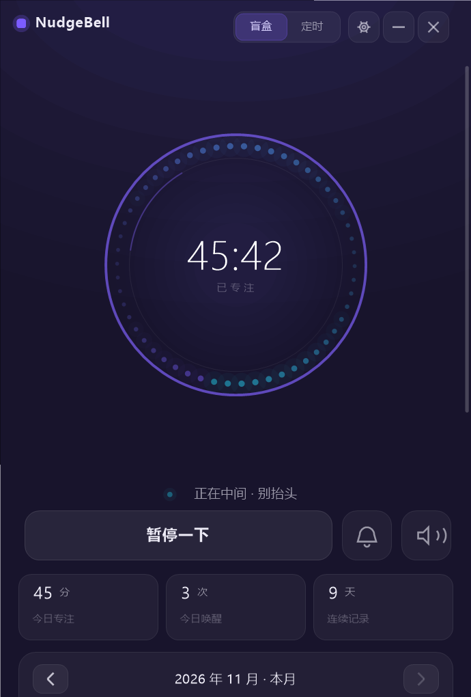
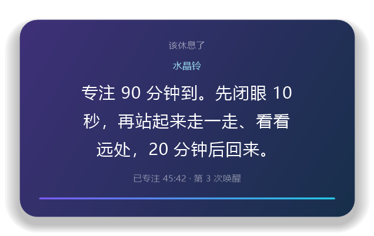
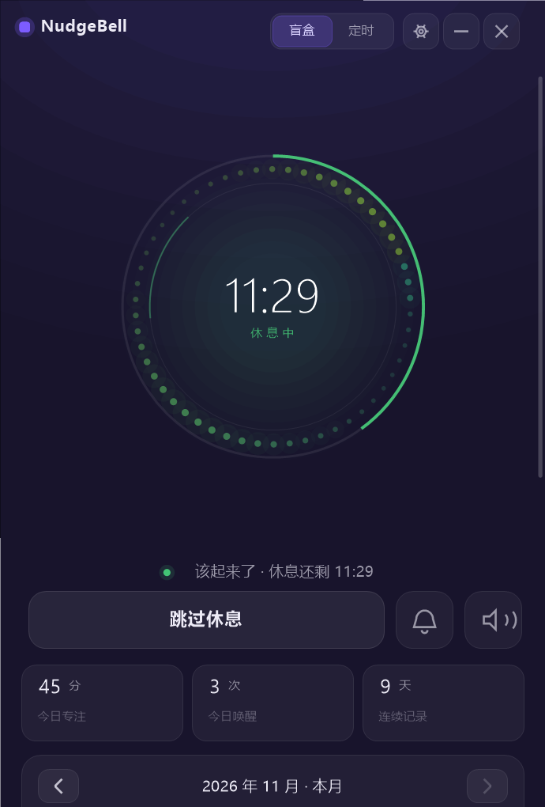
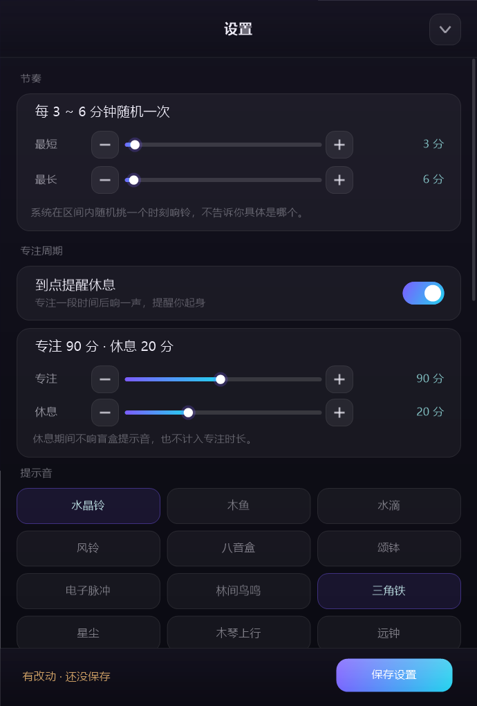
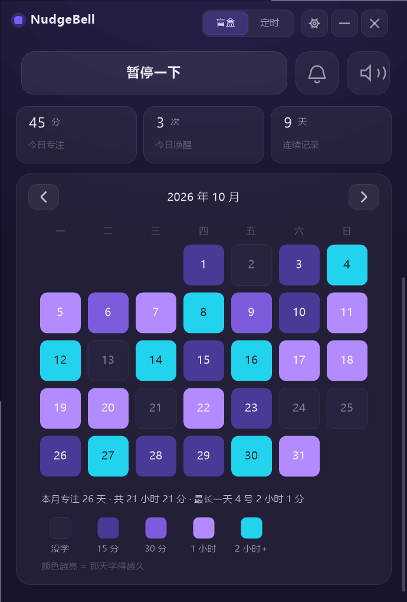

# NudgeBell · 回神


**A randomized focus bell for your desktop.** It rings at an unpredictable
moment — that uncertainty is the whole point. No notifications you can tune out,
no streak guilt. Just a small nudge, at a time you didn't choose, that pulls you
back to whatever you were doing. Native Win32 + GDI+, 916 KB, ~22 MB RAM, no
runtime to install.

> 学习随机提示音。走神的时候，轻轻推你一下。

一个「盲盒式」专注助手。它不催你，也不知道什么时候会响——正是这种不确定，让你在长时间学习里一次次被轻轻拽回当下。

**单文件 916 KB，内存约 22 MB，不装任何运行时，双击即用。**



---

## 目录

- [关于名字](#关于名字)
- [怎么打开](#怎么打开)
- [每月热力图](#月历热力图)
- [90 + 20：专注周期](#90--20专注周期)
- [技术说明](#技术说明)
- [重新编译](#重新编译)
- [自检](#自检)
- [许可](#许可)

---

## 关于名字

`Nudge` 是行为经济学里的「助推」——不强迫、不打断，只在恰当的时刻轻推一下。`Bell` 是那一声钟响。
合起来就是它做的事：在你走神的那一刻，轻轻推你一下。

中文名「回神」。GitHub 上查过，这个名字没有被占用。

---

## 怎么打开

双击 `NudgeBell.exe`。

想放桌面：右键 → 发送到 → 桌面快捷方式。

> 第一次运行 Windows 可能弹「Windows 已保护你的电脑」——因为这个 exe 没有代码签名证书（一张证书一年几百刀，个人项目买不起）。点「更多信息」→「仍要运行」即可。源码就在 `src/`，可以自己编译。

关闭窗口**不算退出**：程序缩到右下角托盘，继续计时——这样你在旁边看书刷题，它照样到点叫你。

真正退出是右键托盘图标 → 退出。退出、注销、关机都会把当前进度**存成暂停态**：那段时间本来就不该算专注，下次打开是「继续专注」按钮等你按，不会自己接着跑。

---

## 什么时候用

**不一定是坐在电脑前。** 把电脑开着放在桌上，人在旁边看书、刷题、写卷子——它照样在后台计时，到点响一声，窗口自己跳到前面给你一句提示，看完继续。

想让它一直待在视野里：在设置里打开「窗口置顶」，把窗口拖到屏幕角落，余光就能看到还剩多久，不用切来切去。

反过来，如果你正在全屏看网课或做别的事，不想被打断：关掉「响铃时浮到前面」，它就只在后台响一声、托盘冒个气泡。

---

## 它怎么工作

**盲盒模式（默认）**
点「开始专注」后，系统在你设的区间里（默认 3~6 分钟）随机挑一个时刻响一声，响完立刻重抽。你不知道它什么时候来，所以不会盯着表，但又始终留着一点注意力在当下——这比定时闹钟管用。

区间怎么设都行：想要密一点就 3~6 分钟，想少被打断就 15~40 分钟，最短和最长是两根独立的滑杆。

**定时模式**
按固定间隔响，适合需要卡点的背诵复盘。

响铃同时弹一张心流卡片，内容是随机一句：深呼吸、抬头看远处、自检刚才那段学到了什么，或者只是「回来就好」。

这张卡是**独立的置顶浮窗**，不依附主窗口——就算主窗口缩在托盘、被其他窗口压住、甚至你正在全屏看网课，它也会浮到屏幕正上方，带阴影和圆角，6 秒后自己退场。点一下卡片立刻收起，不会抢走你正在打字的焦点。



---

## 90 + 20：专注周期

这是默认开启的第二层节奏——一个超日节律（ultradian rhythm）的简化版：**专注 90 分钟，休息 20 分钟**。

跑满 90 分钟，程序响一声、弹一张卡：「该休息了。先闭眼 10 秒，再站起来走一走、看看远处，20 分钟后回来。」接着整圈变成绿色，中心从「已专注」切成倒计时，按钮变成「跳过休息」。20 分钟一到自己回到专注，重新开始下一轮。



几个刻意的设计：

- **休息期间什么都不响**。盲盒提示音在这 20 分钟里彻底停掉，不然刚躺下又被叫起来，休息就白休了。
- **休息不算专注时长**。热力图统计的是真的坐在桌前的时间，把休息算进去只会让自己骗自己。
- **圆环外多了一圈细弧**，就是这一轮的进度。90 分钟走到哪、休息还剩多少，不用去读数字。
- 想改节奏：设置 → 专注周期，专注 5~180 分钟、休息 1~60 分钟随便拖。番茄钟的 25/5 也是这么设。
- 觉得没必要就关掉开关，回到单纯的一层盲盒节奏。

休息时按「跳过休息」，或者直接按空格暂停（暂停连休息一起停住），都可以。

---

## 12 种提示音

全部由程序实时合成，没有一个音频文件：

| | | |
|---|---|---|
| 水晶铃 | 木鱼 | 水滴 |
| 风铃 | 八音盒 | 颂钵 |
| 电子脉冲 | 林间鸟鸣 | 三角铁 |
| 星尘 | 木琴上行 | 远钟 |

每次随机换一个，因为同一个声音听久了会变成「狼来了」。
设置里单击试听，再单击开关是否参与随机。

另有环境音：雨声 / 棕噪音 / 低频，音量可独立调。

---

## 快捷键

| 键 | 作用 |
|---|---|
| `空格` | 开始 / 暂停 |
| `Esc` | 关闭卡片或设置页 |

---

## 设置项

- **盲盒间隔**：最短 ~ 最长两根滑杆，1~40 / 2~90 分钟任意组合，默认 3~6
- **专注周期**：开关 + 专注时长（5~180 分）+ 休息时长（1~60 分），默认 90 / 20
- **音量 / 环境音量**
- **心流卡片**：关掉后不再弹浮窗，只在主窗口角落弹一条短提示
- **系统通知**：窗口在后台时用托盘气泡提醒
- **窗口置顶**：压在别的窗口上，摆桌角当摆件
- **响铃时浮到前面**：不盯屏幕时，响了自动跳出来
- **开机自启**
- **清空今天的数据**：只重置今日，历史曲线保留



每个数字都有三套调法：拖滑杆、点左边的 **−**、点右边的 **+**（− / + 一下一档：时长走 5 分钟或 1 分钟，音量走 5%）。改完面板底部会出现「有改动 · 还没保存」，点**保存设置**写进配置文件；直接关面板或退出也会替你存下，不会悄悄丢。

统计口径：连续记录按「当天专注满 1 分钟」计算；休息时间不计入专注。

---

## 月历热力图

页面往下滚，是一整月的专注日历。每一格就是一格一天，格子里写着日期，颜色代表那天学了多久：

| 颜色 | 含义 |
| --- | --- |
| 近黑空框 | 那天没学 |
| 深紫 | 15 分钟以内 |
| 中紫 | 15 ~ 30 分钟 |
| 浅紫 | 30 分钟 ~ 1 小时 |
| 青色 | 超过 1 小时（日期会反色成深色） |

颜色越亮 = 那天坐得越久，一个月下来哪几天在硬撑、哪几天在摸鱼，扫一眼就知道。



标题两边的箭头可以往前翻月份，最多回看 12 个月——历史记录不会被清掉，换个月份接着看。当天的格子上有一圈白色描边，还没到的日子比「没学」更暗，不会看混。

日历按当月实际周数伸缩：5 周的月份卡片就矮一点，6 周的月份自动变高，不留空白。底部一行是小结——这个月学了多少天、总共多少小时、最长的一天是几号。

---

## 数据在哪

```
%APPDATA%\NudgeBell\state.ini
```

纯本地 ini，不联网、不上传。设置里「打开数据目录」可直接跳转。

---

## 技术说明

纯 Win32 + GDI+ 自绘，C++17，静态链接，不依赖 .NET / Qt / Electron / 浏览器内核。

- 界面：GDI+ 离屏位图渲染，30fps，空闲时自动降帧
- 音效：44.1kHz 单声道 PCM 实时合成（振荡器 + 状态变量滤波器 + 指数包络），经 winmm `waveOut` 输出
- 图标：`res/app.ico` 编进资源，托盘走 `Shell_NotifyIcon`
- 持久化：Win32 INI API
- 圆角：Win11 `DwmSetWindowAttribute(DWMWA_WINDOW_CORNER_PREFERENCE)`

```
src/
├─ main.cpp    窗口、绘制、布局、交互、托盘、持久化
├─ audio.cpp   音色合成引擎 + waveOut 播放
└─ audio.h
res/
├─ app.rc      图标 + manifest
├─ app.ico
└─ app.manifest
build.sh       构建脚本
```

### 重新编译

需要 MinGW-w64（g++ 11+）：

```bash
./build.sh
```

产物 `NudgeBell.exe`，约 860 KB。

### 自检

```bash
./NudgeBell.exe --selftest   # 逻辑层 12 项：音色合成、间隔分布、时间格式、持久化
./NudgeBell.exe --autotest   # 界面层 67 项：重绘、开始/暂停/恢复、响铃弹卡、周期切换、设置页交互
./NudgeBell.exe --shot       # 导出 preview*.png（界面预览，需 mock 数据）
./NudgeBell.exe --capture    # 真弹一张卡片并抓屏，验证浮窗确实合成到了屏幕上
```

结果分别写入 `selftest.txt` / `autotest.txt`。

---

## 为什么不用 Electron

这个软件第一版是 Electron 写的：266 MB，空转 200 MB 内存，一个「偶尔叮一声」的小工具占了半个浏览器。全部重写成原生之后：

| | Electron 版 | 现在 |
|---|---|---|
| 体积 | 266 MB | **916 KB** |
| 内存 | 200 MB+ | **22 MB** |
| 启动 | 1~2 秒 | 瞬间 |
| 依赖 | Chromium + Node | 无 |

---

## 许可

MIT。随便用、随便改，出了问题自己担着。

如果它真的帮你多坐了半小时，那就算值了。
