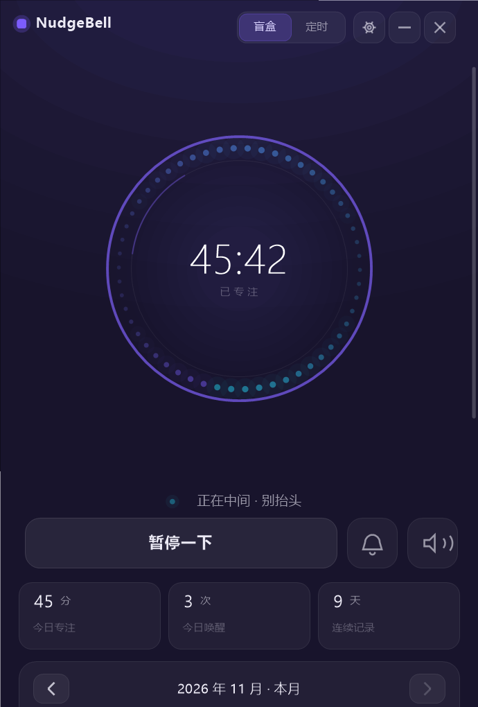
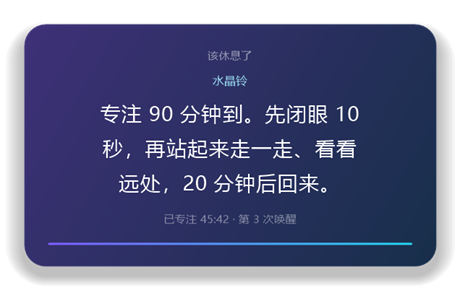
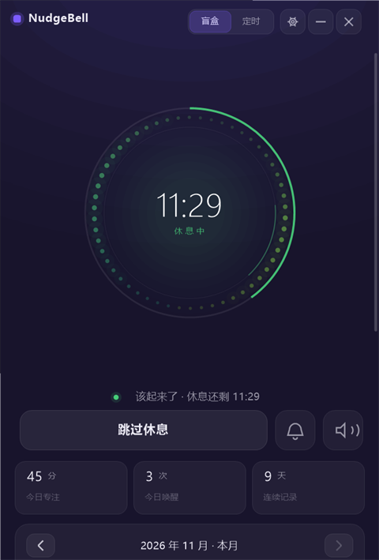
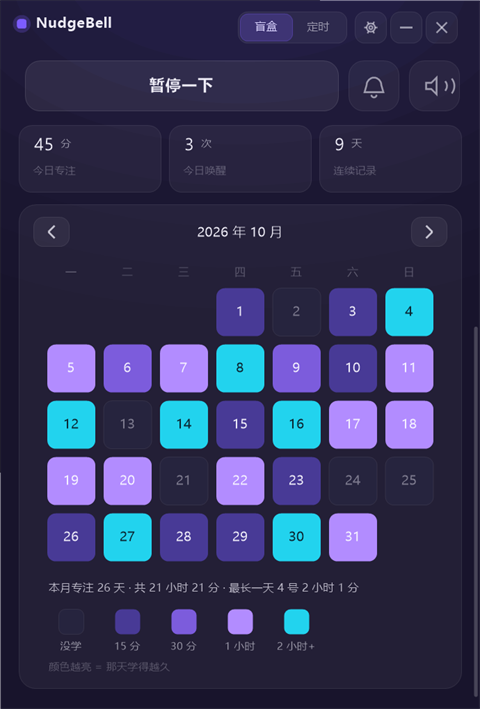
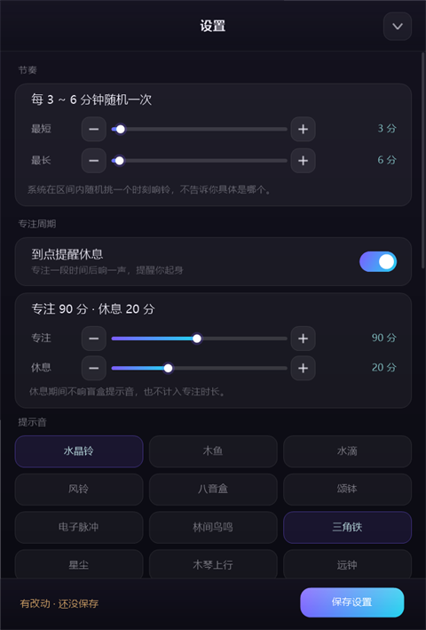

# NudgeBell

[简体中文](README.md) ｜ **English**


**A randomized focus bell for your desktop.** It rings at an unpredictable
moment — and that uncertainty is the whole point.

Most timers fail because you know exactly when they'll fire. You brace for it,
you watch the clock, and after a week the sound becomes background noise. NudgeBell
never tells you when. Every ring re-rolls the interval, so a small part of your
attention stays with the task instead of drifting off to something easier.

No streaks. No guilt. No "you haven't studied in 3 days" notification.

**916 KB single exe · ~22 MB RAM · native Win32 + GDI+ · no runtime to install.**



> This is the English translation. The [Chinese README](README.md) is the
> primary document and may be more up to date.

---

## How it works

**Blind box (default)**
Press *Start*. Somewhere between 3 and 6 minutes — your range, not mine — it
rings once, then re-rolls. You never know when. Both ends of the range are
independent sliders (1–40 / 2–90 minutes), so you can make it nag every 3 minutes
or stay quiet for half an hour.

**Fixed interval**
Rings on an exact cadence. Useful for reciting and spaced review where the
interval itself matters.

Either way you can keep it running while you're *not* at the computer — reading a
textbook, working through problems on paper. The machine sits on your desk, the
bell still fires.

Each ring also pops a card with one random line: breathe, look out the window,
check what you actually just learned, or simply "welcome back".



The card is a **separate top-most window**, not an overlay inside the main window.
It shows up even when the app is minimised to the tray, buried under other windows,
or you're in a fullscreen video. Click anywhere to dismiss; it never steals focus
from what you're typing.

---

## 90 + 20 focus cycle

A simplified ultradian rhythm, on by default: **90 minutes of focus, 20 minutes
off**.

At minute 90 it rings, pushes a card ("stand up, look far away, come back in 20"),
and the ring turns green. The centre switches from elapsed time to a countdown,
and the main button becomes *Skip break*. When the 20 minutes are up it slides
back into focus by itself.

A few deliberate choices:

- **Total silence during breaks.** The random bells are suspended, not just muted.
  Getting called 40 seconds after you lay down isn't a break.
- **Break time doesn't count as focus.** The heatmap records time actually spent
  at the desk. Padding it only fools yourself.
- **A thin arc outside the ring** shows progress through the current phase, so you
  don't have to read a number to know where you are.
- Configurable: 5–180 min focus, 1–60 min break. Want a 25/5 pomodoro? Drag it.



---

## Monthly heatmap

Scroll down and you get a calendar of the month. Each cell is a day, the number is
the date, and the colour is how long you sat there:

| Colour | Meaning |
|---|---|
| near-black outline | nothing that day |
| dark purple | under 15 min |
| purple | 15–30 min |
| light purple | 30 min – 1 h |
| cyan | over 1 h (date turns dark for contrast) |

Brighter means longer. A month at a glance tells you which days you were actually
working and which days you were just sitting near an open book.

Arrows next to the title go back up to 12 months. The card grows and shrinks with
the number of weeks in the month, so there's no dead space.



---

## 12 notification sounds

All synthesised at runtime — there is not a single audio file in this repo:

| | | |
|---|---|---|
| Crystal | Wooden fish | Water drop |
| Wind chime | Music box | Singing bowl |
| Electronic pulse | Forest birds | Triangle |
| Stardust | Marimba rise | Distant bell |

A different one is picked each time, because the same sound repeated for a month
stops being a signal and becomes wallpaper. Click to audition in settings, click
again to include or exclude it from the pool.

Three ambient beds too: rain, brown noise, low frequency, with their own volume.

---

## Settings

Every number has three ways to change it: drag the slider, tap **−** on the left,
tap **+** on the right. Changes are applied live but only written to disk when you
hit **Save** in the bottom bar (closing the panel saves too — nothing gets
silently lost).



| | |
|---|---|
| Random interval | 1–40 / 2–90 min, default 3–6 |
| Focus cycle | on/off, 5–180 min focus, 1–60 min break, default 90/20 |
| Volume / ambient volume | independent |
| Flow card | floating card on or off |
| System notification | tray balloon when the window is hidden |
| Always on top | park the window in a corner |
| Bring to front | raise the window on ring when the card is off |
| Launch at startup | |
| Clear today | resets today only, history kept |

---

## Shortcuts

| Key | Action |
|---|---|
| `Space` | start / pause |
| `Esc` | close card or settings |

---

## Where's my data

```
%APPDATA%\NudgeBell\state.ini
```

A plain local ini. No network, no telemetry, no account. "Open data folder" in
settings jumps straight there.

---

## How it's built

Pure Win32 + GDI+ custom drawing, C++17, statically linked. No .NET, no Qt, no
Electron, no browser engine.

- **UI**: GDI+ into an offscreen bitmap, 30 fps, drops to 6 fps when idle
- **Audio**: 44.1 kHz mono PCM synthesised on the fly (oscillators + state
  variable filter + exponential envelope) through winmm `waveOut`
- **Floating card**: layered window — rendered into a 32-bit premultiplied-alpha
  DIB and pushed with `UpdateLayeredWindow`, which is the only way to get real
  transparent rounded corners and a soft shadow
- **Icon**: compiled into resources, tray via `Shell_NotifyIcon`
- **Persistence**: Win32 INI API
- **Rounded corners**: `DwmSetWindowAttribute(DWMWA_WINDOW_CORNER_PREFERENCE)`

```
src/
├─ main.cpp    window, drawing, layout, input, tray, persistence
├─ audio.cpp   synth engine + waveOut playback
└─ audio.h
res/
├─ app.rc      icon + manifest
├─ app.ico
└─ app.manifest
build.sh       build script
```

### Build

Requires MinGW-w64 (g++ 11+):

```bash
./build.sh
```

Produces `NudgeBell.exe`, ~916 KB.

### Tests

```bash
./NudgeBell.exe --selftest   # 12 logic checks: synthesis, interval distribution, formatting, persistence
./NudgeBell.exe --autotest   # 67 UI checks: repaint, start/pause/resume, ring + card, cycle switching, settings input
./NudgeBell.exe --shot       # export preview*.png (UI screenshots with mock data)
./NudgeBell.exe --capture    # pop a real card and screen-capture it, to prove the window actually composites
```

Results land in `selftest.txt` / `autotest.txt`.

---

## Why not Electron

The first version of this was Electron: 266 MB, 200 MB of RAM idling, half a
browser for a thing that occasionally goes *ding*. Rewritten in raw Win32:

| | Electron | Now |
|---|---|---|
| Size | 266 MB | **916 KB** |
| RAM | 200 MB+ | **22 MB** |
| Startup | 1–2 s | instant |
| Runtime | Chromium + Node | none |

---

## Notes

- **Windows only.** Win32 API, GDI+, `waveOut` — nothing portable here.
- **The exe is unsigned**, so the first launch trips SmartScreen ("Windows
  protected your PC"). Click *More info* → *Run anyway*. A code signing
  certificate costs a few hundred dollars a year; this is a personal project.
  The source is in `src/`, build it yourself if you'd rather.
- **Closing the window is not quitting.** It hides to the tray and keeps counting.
  Actual quit is in the tray menu. Quitting, logging off or shutting down saves
  the session as *paused* — time when the app isn't running shouldn't count as
  focus, and reopening won't silently resume on you.

---

## License

MIT. Use it, change it, ship it. No warranty.
